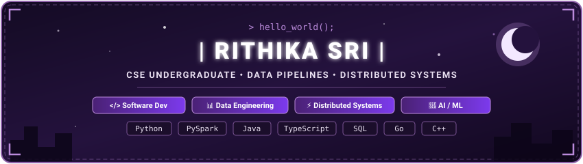

  

  
  
  

  
  
  

---

## ✦ About Me

I'm **Rithika Sri**, a Computer Science student and software engineer focused on **Data Engineering, Distributed Systems, and Intelligent Developer Tooling**.

I enjoy turning programming concepts into working software, understanding how systems fit together, and improving one project at a time. My interests include **distributed data pipelines (PySpark & BigQuery), AST-level static analysis (Tree-sitter), and local-first software architecture**.

Outside coding, I focus on system design fundamentals, problem solving, and building tools that make engineering workflows simpler.

## 🛠 Tech Stack

### Languages & Markup

  

**Programming:** `Python` · `Java` · `TypeScript` · `JavaScript` · `Go` · `C++` · `SQL`  
**Markup:** `HTML5` · `CSS3`

### Data, Cloud & Platforms

  

`Apache Spark` · `Google BigQuery` · `Google Cloud Storage` · `PostgreSQL` · `Docker` · `GCP` · `AWS`

### IDEs & Developer Tools

  

`Visual Studio Code` · `IntelliJ IDEA` · `Git` · `GitHub` · `FastAPI` · `React` · `Three.js` · `Vite`

### Technical Foundations

`Data Structures` · `Algorithms` · `Distributed Systems` · `AST Syntax Parsing` · `Database Internals` · `Problem Solving`

## 📂 Featured Projects

  
  

<strong>✦ Gig Credit Passport — Features & technical highlights</strong>

A worker-owned financial identity & explainable credit scoring engine built on India's Account Aggregator framework.

- Consent-driven banking data ingestion using India's Account Aggregator protocol
- Supplementary OCR-based invoice and earnings parser with cross-verification
- Transparent, audit-ready credit scoring formula with zero predatory black-boxes
- Production backend architecture with FastAPI, Alembic schema migrations, and PostgreSQL

**Skills:** Python, FastAPI, Alembic, PostgreSQL, Docker, Account Aggregator Framework.

[View project documentation](https://github.com/Rithikasri-code/gig-credit-passport)

<strong>✦ Impact Engine — Features & technical highlights</strong>

A semantic code search and regression blast-radius analysis engine for large codebases.

- Safe recursive repo walking defending against path traversal and symlink escapes
- Tree-sitter AST extraction for Python & Go (functions, classes, calls, and hash-based diffs)
- Call-graph resolution engine mapping caller-callee dependencies
- Validated against historical bug-fix commits to predict breaking changes

**Skills:** Python, Go, Tree-sitter, AST Parsing, Call-Resolution Graphs.

[View project documentation](https://github.com/Rithikasri-code/impact-engine)

Both applications are fully open-source and documented in their respective repositories.

## ☾ Currently Exploring

- Strengthening distributed stream processing & real-time analytics
- Exploring compiler optimization, AST transformations, and static analysis
- Deepening knowledge of storage engines, database internals, and concurrency
- Building deterministic, local-first web applications

## 📊 GitHub Activity

  

  

Activity cards reflect public repository commits and code distribution.

---

  <strong>✦ Code · Build · Learn ✦</strong> 
  Thanks for visiting my corner of GitHub.

