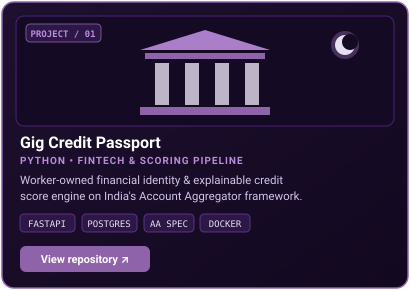
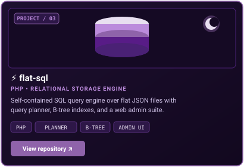

  

  
  
  
  

 

<h2 align="center"> <em>About me</em> </h2>

<table>
  <tr>
    <td width="65%" valign="top">
      

        Hello There! <em><b>I'm Rithika Sri</b></em>, a Computer Science student and software engineer focused on <b>Data Engineering &amp; Distributed Systems</b>.
      

      

        I enjoy understanding how complex systems fit together, optimizing data locality, and architecting robust, verifiable data pipelines. My core focus lies in turning theoretical system concepts into resilient software—from <b>distributed ETL architectures (PySpark, BigQuery)</b> to <b>AST-level code analysis (Tree-sitter)</b> and <b>local-first storage engines</b>.
      

       
      

        🎓 &nbsp; <b>CS Undergraduate</b> &nbsp;|&nbsp; <em>Specializing in Systems Architecture</em> 
        ⚡ &nbsp; <b>Data Engineering</b> &nbsp;|&nbsp; <em>Distributed Pipelines with PySpark &amp; BigQuery</em> 
        🔍 &nbsp; <b>Compiler Tooling</b> &nbsp;|&nbsp; <em>AST Syntax Analysis with Tree-sitter</em> 
        🛡️ &nbsp; <b>Fintech Protocols</b> &nbsp;|&nbsp; <em>India's RBI Account Aggregator Framework</em>
      

    </td>
    <td width="35%" align="center" valign="middle">
      
    </td>
  </tr>
</table>

 
 

<h2 align="center"> <em> Technologies </em> </h2>

  
  
  
  
  
  
  
  
  
  
  
  
  
  
  
  
  
  

 

<h2 align="center"> <em> Featured Projects </em> </h2>

  
  

  
  

 

<h2 align="center"> <em> Statistics </em> </h2>

  
  

 

  

 

---

  <strong>✦ Code · Build · Learn ✦</strong> 
  Thanks for visiting my corner of GitHub.

