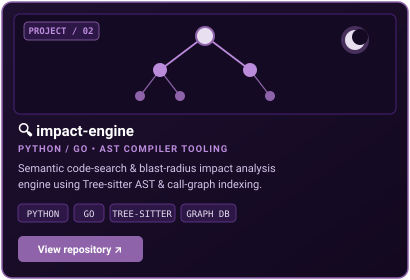
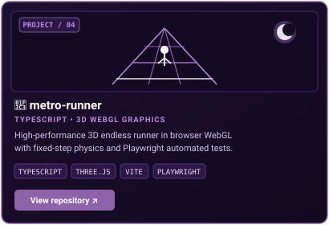

  

  
  
  

  
  
  
  

 

<h2 align="center"> <em>✦ About Me </em> </h2>

<table>
  <tr>
    <td width="65%" valign="top">
      

        Hello There! <em><b>I'm Rithika Sri</b></em>, a Computer Science student and software engineer focused on <b>Data Engineering &amp; Distributed Systems</b>.
      

      

        I enjoy turning theoretical system concepts into resilient, working software—understanding how distributed pipelines scale, optimizing data locality, and building verifiable software. My core focus spans <b>distributed ETL (PySpark, BigQuery), AST-level static analysis (Tree-sitter), and local-first storage engines</b>.
      

       
      

        🎓 &nbsp; <b>CS Undergraduate</b> &nbsp;|&nbsp; <em>Specializing in Systems Architecture</em> 
        ⚡ &nbsp; <b>Data Engineering</b> &nbsp;|&nbsp; <em>Distributed Pipelines with PySpark &amp; BigQuery</em> 
        🔍 &nbsp; <b>Compiler Tooling</b> &nbsp;|&nbsp; <em>AST Syntax Analysis with Tree-sitter</em> 
        🛡️ &nbsp; <b>Fintech Protocols</b> &nbsp;|&nbsp; <em>India's RBI Account Aggregator Framework</em>
      

    </td>
    <td width="35%" align="center" valign="middle">
      
    </td>
  </tr>
</table>

 
 

<h2 align="center"> <em>🛠 Tech Stack </em> </h2>

  

  <b>Programming:</b> <code>Python</code> · <code>Java</code> · <code>TypeScript</code> · <code>JavaScript</code> · <code>Go</code> · <code>C++</code> · <code>SQL</code> &nbsp;|&nbsp; <b>Markup:</b> <code>HTML5</code> · <code>CSS3</code>

  

  <code>Apache Spark</code> · <code>Google BigQuery</code> · <code>Cloud Storage</code> · <code>PostgreSQL</code> · <code>Docker</code> · <code>GCP</code> · <code>AWS</code>

  

  <code>Visual Studio Code</code> · <code>IntelliJ IDEA</code> · <code>Git</code> · <code>GitHub</code> · <code>FastAPI</code> · <code>React</code> · <code>Three.js</code> · <code>Vite</code>

 

<h2 align="center"> <em>📂 Featured Projects </em> </h2>

  
  

  
  

 

<h2 align="center"> <em>📊 Statistics </em> </h2>

  
  

  

 

---

  <strong>✦ Code · Build · Learn ✦</strong> 
  Thanks for visiting my corner of GitHub.

